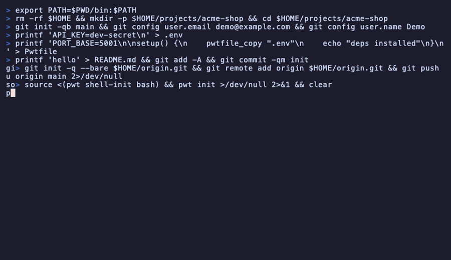
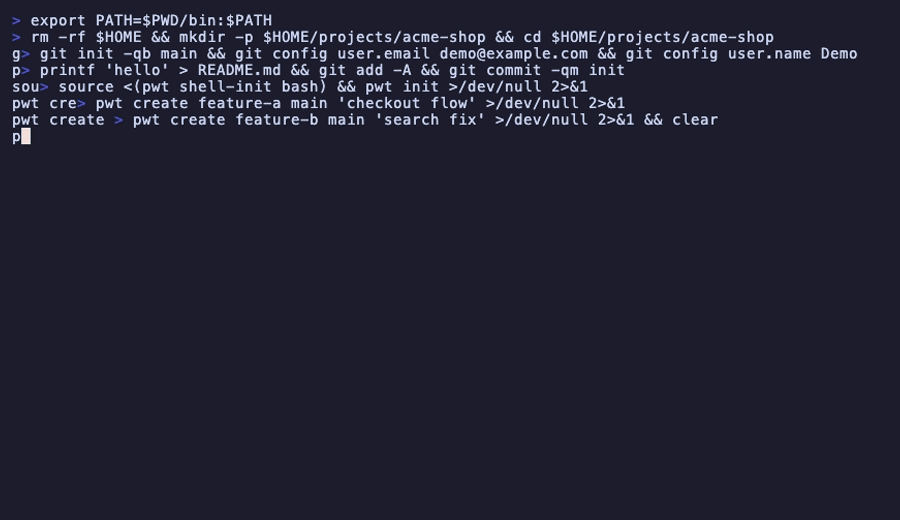

# pwt - Power Worktrees

**A powerful Git worktree workflow for today's multi-project development.**

[](https://github.com/jonasporto/pwt/actions/workflows/test.yml)
[](LICENSE)
[](CHANGELOG.md)

**[Website](https://jonasporto.github.io/pwt/)** ·
[Docs](https://jonasporto.github.io/pwt/docs/) ·
[Blog](https://jonasporto.github.io/pwt/blog/)

## Demos

Quick start: `pwt create` allocates a port, runs the setup hook, copies `.env`:



`pwt use`: one stable path for your editor, branches swap underneath:



`pwt ports`: every project on the machine, one registry:


`pwt jobs`: background work with an exit you can wait on:


[Watch the full overview (mp4)](examples/videos/00-overview.mp4), or see
them play as video on the [website](https://jonasporto.github.io/pwt/).
Tapes and how to re-record: `examples/README.md`.

---

✅ Work in parallel: multiple projects, or parallel changes within the same project

✅ One stable workflow: keep one editor open, swap branches underneath it

✅ No local conflicts: automatic per-worktree ports, predictable dev servers

✅ Project-aware automation: run setup, servers, and custom commands via Pwtfile

✅ Built on Git worktrees: clones when isolation is required

---

## When pwt beats raw `git worktree`

| You are hitting | pwt answer |
|-----------------|------------|
| "Port already in use" running dev servers on two branches | A stable port per worktree (`$PWT_PORT`), servers started with it |
| Several agents/people on the same repo, branches switching underneath | One isolated worktree each, jump with `pwt <worktree>` |
| Fresh checkout fails until `.env`/deps/symlinks are hand-copied | `setup()` hook runs on every create/adopt (Pwtfile) |
| Scripts sleep-polling for a server or job | `pwt server wait --log-contains`, `pwt jobs wait` (exit 5 on timeout) |
| Starting a server hangs the agent's shell | `pwt server --bg` daemonizes; `pwt jobs list --porcelain` tracks it |
| Parsing human-formatted CLI output | `--porcelain`/`--json` everywhere + a stable exit-code contract |
| Browser tests need one URL while the target branch changes | `pwt gateway` routes a stable URL to any worktree |
| Ten worktrees, each with a dev server eating memory | `pwt router` keeps a port open per worktree, starts the server on the first request, stops it when idle |
| Several projects on one machine keep claiming the same port | Ports are allocated machine-wide; `pwt ports` shows every allocation and flags conflicts |

A one-off second checkout with no server and no setup? Raw `git worktree
add` is fine; pwt earns its keep when the lifecycle around the worktree
(ports, setup, servers, jobs) is the problem.

---

## One setup, every agent

Claude Code, Codex, Cursor and the rest each create worktrees their own way,
and each has its own answer for the setup problem: `.worktreeinclude` here, a
`WorktreeCreate` hook there, nothing at all in most. Define it once in a
Pwtfile and every tool lands on the same ready checkout, with its own port,
its own database and its own generated config.

| Without pwt | With pwt |
|---|---|
| Setup defined per tool, in four formats that drift | One `Pwtfile`, versioned in the repository |
| Each tool's port logic (or none), colliding across projects | Machine-wide allocation; `pwt ports` shows who owns what |
| No inventory of what agents created | `pwt list`, `pwt ports`, `pwt jobs`, whoever created it |
| A tool that creates worktrees its own way is a dead end | `pwt adopt` registers it afterwards: port, metadata, setup |

Three ways to make an agent use it, strongest last:

```bash
# 1. Instruct: in CLAUDE.md / AGENTS.md of the project
#    "worktrees are created with `pwt create`, never `git worktree add`"

# 2. Enforce (Claude Code): .claude/settings.json
#    { "permissions": { "deny": ["Bash(git worktree add *)"] } }

# 3. Adopt whatever arrives by any other path
pwt adopt          # inside the worktree someone else created
pwt adopt --all    # every unregistered worktree in the directory
```

---

## Install

### Homebrew

```bash
brew install jonasporto/pwt/pwt
```

### npm

```bash
npm i -g @jonasporto/pwt
```

### npx (without installing)

```bash
npx @jonasporto/pwt --help
```

### bun

```bash
bun add -g @jonasporto/pwt
```

### bunx (without installing)

```bash
bunx @jonasporto/pwt --help
```

### curl

```bash
curl -fsSL https://raw.githubusercontent.com/jonasporto/pwt/main/install.sh | bash
```

**Dependencies:** `git` (required). `fzf`, `lsof` (optional but highly recommended; on Linux `ss` or `fuser` stand in for `lsof`). `node` for `pwt gateway` and `pwt router`. `perl` is optional: background jobs and daemons fall back to a subshell plus `setsid` when it is absent. `jq` is only needed once, to convert state written before schema v2.

See [INSTALL.md](INSTALL.md) for shell setup and troubleshooting.

---

## Quick Start

```bash
cd ~/projects/myapp
pwt init                        # Initialize project
pwt add feat/user-auth          # Create worktree from branch
pwt feat/user-auth              # Jump to a worktree
pwt server --bg                 # Start its dev server, detached
pwt server wait                 # Block until it actually answers
pwt list                        # List worktrees with git status
```

### Custom commands (Pwtfile)

Any function in the project's `Pwtfile` becomes a `pwt` command:

```bash
pwt editor                      # Open editor in current worktree
pwt build                       # Run build command
pwt server                      # Start dev server (auto port allocation)
pwt test --bg                   # Any Pwtfile command, daemonized
```

---

## Ports

Every worktree gets a port at creation, recorded in pwt's state. Allocation
is machine-wide: a new worktree never takes a port another project already
owns, whether or not that project's server happens to be running.

```bash
pwt ports            # every allocation, every project, conflicts flagged
pwt ports --json     # same, machine-readable
pwt port TICKET-123  # just the number, for scripts
pwt fix-port <wt>    # move a worktree off a port that is taken or claimed twice
```

A port held by a system daemon rather than a dev server shows as `system`,
not `listening`: on macOS, AirPlay Receiver binds 5000 and 7000, which is
where Flask, Rails and most base-port conventions start.

`$PWT_PORT` carries the number into `Pwtfile` hooks, so servers and generated
config never hard-code it.

---

## Multi-Project

```bash
# See all configured projects
pwt project

# Jump to a worktree in another project
pwt backend security-patch

# Quick switch to another project's main
pwt backend

# Run commands in any project
pwt backend build
pwt backend server
```

A project named after a builtin command (`ports`, `jobs`, ...) resolves to
the command, with a stderr warning. Reach the project through its alias or
`pwt --project <name>`; set an alias with `pwt project alias <name> <short>`.

---

## Pwtfile

Project-specific hooks.
Think *Makefile*, but for worktree lifecycle.

`pwt` core stays project-agnostic: it manages worktrees, metadata, port
allocation, navigation, background job bookkeeping, and delegation. Project
details such as dependency installation, databases, asset watchers, queues,
tests, and cleanup commands belong in the Pwtfile.

```bash
# Pwtfile
PORT_BASE=5001

setup() {
    pwtfile_copy ".env.local"
    pwtfile_symlink ".cache"
    # ignore generated files repo-locally (.git/info/exclude: never
    # committed, one call covers every worktree of the repo)
    pwtfile_git_exclude "pnpm-lock.yaml" "pnpm-workspace.yaml"
    ./scripts/setup
}

server() {
    # remove --kill-server delegates here meaning "stop and return"
    if [ "${PWT_KILL_TARGET:-}" = "server" ]; then
        pwtfile_stop_jobs server    # this worktree's jobs only
        return 0
    fi
    case "${1:-start}" in
        start) exec env PORT="$PWT_PORT" ./scripts/dev ;;
        stop) ./scripts/dev-stop ;;
    esac
}

# Runs as part of `pwt doctor`: pwt checks the machine and the worktree
# layout, the project checks whatever "healthy" means for its own stack.
doctor() {
    [ -d node_modules ] || echo "⚠ dependencies not installed"
    [ -s .npmrc ] || echo "⚠ .npmrc is empty (registry auth missing)"
}
```

Command params are available as `$1`, `$2`, etc. and as raw `$PWT_ARGS`.
Remove cleanup can delegate to any Pwtfile command with `--kill-<command>`;
for example, `pwt remove FEATURE --kill-worker` calls `worker --kill`.

A project can also own its branch-naming convention with a `branch_name()`
hook: it receives the worktree name and description and prints the branch to
create (`--branch` always wins, and returning nothing falls back to pwt's
default). See `examples/Pwtfile.reference` for the full semantics.

A version manager that switches on a shell hook (`mise activate`, direnv,
nvm, chruby) never fires in the subshell pwt runs commands in, so a command
gets the tools of wherever pwt was called from. An `environment()` hook
prints shell assignments for the worktree it runs in, and pwt applies them
before `pwt run`, `for-each` and every Pwtfile command (setup on create,
`server`, background jobs):

```bash
# In ~/.pwt/Pwtfile (every project) or the project's Pwtfile
environment() {
    mise env -s bash          # or: direnv export bash
}
```

The global Pwtfile's assignments come first and the project's last, so the
project wins. A failing `environment()` warns and the command runs without
it. `pwt environment [worktree]` prints the same lines for anything that runs
outside pwt: `eval "$(pwt environment)"` in a script, or an agent's shell
that sources an env file.

Pwtfile commands can be called with progressively less context:

```bash
pwt <project> <worktree> <command> [args...]  # From anywhere
pwt <worktree> <command> [args...]            # From inside the project
pwt <command> [args...]                       # From inside the worktree
```

### Boot progress

Every `pwt server` boot writes one JSON line per step to
`~/.pwt/state/<project>/<worktree>.boot.jsonl`: pwt's own steps (`boot`,
`spawn`, `environment`, `listen`) plus whatever `server()` wraps in
`pwt_step`. The last successful boot is kept as `<worktree>.boot.prev.jsonl`,
which is what wait estimates are computed from.

```bash
server() {
    pwt_step deps bundle install
    pwt_step assets --skip "built on setup"
    exec bin/rails server -p "$PWT_PORT"
}
```

```bash
pwt server feat-x --bg --progress json
# {"ts":"...","ts_ms":...,"project":"app","worktree":"feat-x","step":"deps","state":"done","duration_ms":812,"detail":""}
# ...
# {"ts":"...","step":"boot","state":"done","duration_ms":4210,"detail":""}
```

With `--bg --progress json`, stdout carries only those lines (human output
goes to stderr) and pwt exits when the boot ends: 0 listening, 1 failed,
5 timed out. A `state` is `start`, `done`, `fail` or `skip`.

**Variables:** `$PWT_PORT`, `$PWT_WORKTREE`, `$PWT_WORKTREE_PATH`,
`$PWT_BRANCH`, `$PWT_TICKET`, `$PWT_PROJECT`, `$PWT_ARGS`, `$MAIN_APP`;
`$PWT_AGENT=1` when running under `--no-input`. Also always defined (empty
when they do not apply), so `set -u` Pwtfiles are safe:

| Variable | Value |
|----------|-------|
| `$PWT_PUBLIC_PORT` | The stable port `pwt router` serves this worktree on (`$PWT_PORT` + `port_offset`) |
| `$PWT_PUBLIC_URL` | `http://localhost:$PWT_PUBLIC_PORT` |
| `$PWT_BOOT_FILE` | The progress file of the server boot in progress |
| `$PWT_CHANGED_FILES` | In `repoint()`: changed paths, one per line |
| `$PWT_PREVIOUS_COMMIT` | In `repoint()`: the commit the worktree was on |
| `$PWT_HOST`, `$PWT_URL`, `$PWT_HOSTS`, `$PWT_DOMAIN`, `$PWT_HOST_<ALIAS>` | Router host names; filled only with `pwt router config host_routing true` |

Run `pwt help pwtfile` for full syntax.

---

## Shell Integration

```bash
# Add to ~/.zshrc or ~/.bashrc
eval "$(pwt shell-init zsh)"
```

Enables `pwt cd`, `pwt cd @`, `pwt cd -`, and tab completion.

`pwt cd` takes a worktree name, a branch name, `@` (main), `@there` or
`-` (previous), then falls back to a name/description search.

`@there` is for the moment git refuses a checkout:

```bash
$ git checkout feature/login
fatal: 'feature/login' is already checked out at '/path/to/app-worktrees/login'
$ pwt @there      # and you are in app-worktrees/login
```

The wrapper reads the previous command line from the shell's history
and resolves the branch named there to its worktree (main included).
Nothing to copy or retype. Newer git words the refusal as "is already
used by worktree at"; same moment, same answer. Without the shell
integration, `@there` has no previous line to read and says so.

---

## Everyday Commands

| Command | Description |
|---------|-------------|
| `init` | Initialize project in current repo |
| `create <name> [base] [desc]` | Create worktree: port, metadata, setup hook (`add` is an alias) |
| `track <remote-branch>` | Create worktree tracking an existing remote branch |
| `adopt [path]` | Register an existing worktree and run setup |
| `list` | List worktrees with git status (`--dirty`, `--porcelain`) |
| `cd <worktree>` | Navigate to worktree (`@` main, `-` previous, `--select`) |
| `use <worktree>` | Point the stable `current` symlink at a worktree |
| `project` | List all configured projects |
| `<worktree>` | Navigate to worktree inside the current project (any unique fragment matches: `pwt 1234` finds `TICKET-1234-fix-login`) |
| `<project> <worktree>` | Jump to worktree in another project |
| `run <worktree> <cmd>` | Run a command inside that worktree |
| `environment [worktree]` | Print the worktree's `environment()` assignments (`eval "$(pwt environment)"`) |
| `for-each <cmd>` | Run a command in the main checkout and every worktree |
| `editor` | Open editor in current worktree |
| `server` | Start dev server (from Pwtfile) |
| `server wait [worktree]` | Block until the server is ready (`--log-contains`, `--timeout`) |
| `server <wt> --bg --progress json` | Start and stream the boot steps until the server listens |
| `jobs wait <id\|worktree>` | Block until a background job finishes (`--timeout`) |
| `gateway` | Stable project URL that routes to a worktree server |
| `servers` | Show active servers, gateway target, and background jobs (`--json`) |
| `servers stop <worktree>` | Stop a worktree's background server (`--idle`: refuse while busy) |
| `router` | Stable public port per worktree: wake on request, idle stop, server cap |
| `repoint <worktree> <ref>` | Move a worktree to another commit, detached, keeping its port and caches |
| `logs [worktree]` | Show background job logs (`-f` to follow) |
| `ports` | Machine-wide port registry: every allocation, every project, conflicts flagged |
| `meta set <wt> <key> <val>` | Free-form worktree metadata (what dashboards read) |
| `doctor` | Check machine, project layout, and the Pwtfile's own `doctor()` hook |
| `self` | List installed pwt versions / switch active (`self use <target>`) |
| `remove <worktree>` | Remove worktree (`--with-branch`, `--kill-port`) |
| `auto-remove [target]` | Bulk-remove merged worktrees (dry-run by default, `--execute`) |
| `restore [backup] [wt]` | Recover uncommitted work that `remove` backed up to trash |
| `state --json` | Versioned JSON snapshot of all pwt state (projects, worktrees, jobs) |

---

## Existing Remote Branches

Use `track` when you want to edit an existing remote branch directly without applying your configured `branch_prefix`:

```bash
pwt track origin/team/PROJ-1234
```

This creates a worktree named `PROJ-1234`, a local branch named `team/PROJ-1234`, configures tracking to `origin/team/PROJ-1234`, allocates metadata/port, and runs normal setup hooks.

Override the worktree name when the branch does not contain a clear ticket:

```bash
pwt track origin/team/fix-login-flow --name login-flow
```

Equivalent explicit `create` form:

```bash
pwt create PROJ-1234 --branch team/PROJ-1234 --from origin/team/PROJ-1234
```

A worktree pinned to an exact commit, with no branch at all, is
`--detach`:

```bash
pwt create review-1 3f2a9c1 --detach
```

`<name>` only names the worktree; a ref this clone lacks is fetched by
name. To move such a worktree to another commit later without redoing its
setup, see [Repoint](#repoint). `create` makes the new worktree current;
`--no-use` leaves the current one alone (service slots, scripts).

If a worktree was already created with raw Git, adopt it into pwt:

```bash
pwt adopt /path/to/worktree
# or, from inside it
pwt setup
```

Adopted worktrees can live outside the configured `worktrees_dir`. pwt records
their real path in metadata, allocates a port, runs normal setup hooks, and then
includes them in `pwt list`, `pwt list --names`, `pwt cd`, `pwt use`,
`pwt current`, and `pwt info`.

---

## Stable Gateway

Each worktree keeps its own allocated port, but you can also run one stable
project-scoped gateway URL and switch which worktree it targets:

```bash
pwt gateway up --port 5999 --host localhost
pwt gateway use PROJ-1234
open "$(pwt gateway url)"
```

`pwt gateway up` runs a small local proxy daemon for the current project.
`pwt gateway use <worktree>` points new connections at that worktree's
allocated server port. If the target port is not listening and the project
Pwtfile defines `server()`, pwt starts it with `pwt server <worktree> --bg`
before switching the gateway.

The public gateway URL defaults to `localhost` so browser cookies and sessions
are shared with direct local app URLs such as `http://localhost:5001`. Set
`gateway_host` or pass `--host` when a project should use another loopback
hostname or IP:

```bash
pwt config gateway_host 127.0.0.1
pwt gateway up --port 5999 --host app.localhost
```

Custom hosts must resolve to loopback and may need to be allowed by the app's
development host configuration. The proxy still binds to loopback only.

Gateways are scoped by project:

```bash
pwt gateway down          # current project
pwt backend gateway down  # explicit project/alias from anywhere
```

Use `pwt servers` to see the gateway, current target, running server jobs, and
active ports. Add `--all` to include stopped worktrees. `pwt servers --json`
adds, per worktree, its public router port and URL, the last request the
router saw, requests in flight, and a boot summary
(`{"state":"done","duration_ms":4210,"last_good_ms":4210}`).
`pwt servers stop <worktree>` stops its background server.

---

## Router: wake on request, stop when idle

The gateway gives a project one URL. The router gives every worktree of every
project its own stable port, and owns that port while the server sleeps:

```bash
pwt router up
pwt router routes          # PUBLIC  PROJECT  WORKTREE  PORT
open "$(pwt router url feat-x)"   # http://localhost:15012
```

The public port is the worktree's pwt port plus `port_offset` (default 10000:
5012 becomes 15012). The server keeps binding `$PWT_PORT`; the router
forwards to it, HTTP and WebSocket, with `X-Forwarded-For/Host/Proto/Port`.

- **Wake.** A request to a stopped server runs `pwt server <wt> --bg`. A
  browser gets a page that shows the boot steps live, each with the time it
  took last boot, and reloads the original URL when the server listens. Other
  clients are held up to `hold_seconds` (30), then get 503 with
  `Retry-After`. A boot that fails, or passes `boot_timeout` (120 s), shows
  the error and the job log tail (`expose_logs false` hides the log).
- **Idle stop.** A server no request reached through the router for
  `idle_minutes` (30) is stopped with `pwt servers stop --idle`, which refuses
  while a request or websocket is in flight or another pwt job runs for that
  worktree. Only servers that got router traffic are stopped: one an agent
  uses directly on `$PWT_PORT` is left alone.
- **Cap.** `max_servers` (0 = no cap) bounds the running pwt servers on the
  machine. A `pwt server --bg` over the cap, including a wake, first stops
  the least recently used idle server, and exits 4 when every one is busy.
  The main app (`@`) is never counted nor stopped.

```bash
pwt router config max_servers 2
pwt router config idle_minutes 15
pwt router config                # every setting with its value
pwt router status --json
pwt router up --foreground       # attached, for systemd or a container
```

TLS stays outside pwt: put a TLS proxy or tunnel in front of a public port.
Routing by host name on the router's own port (`<worktree>.<project>.localhost`,
with extra names from a Pwtfile `hosts()` function) is available behind
`pwt router config host_routing true`; run `pwt router help` for its settings.

---

## Repoint

A worktree whose setup is expensive (dependencies, a database, warm caches)
can move to another commit without being rebuilt:

```bash
pwt repoint run-slot-1 origin/main
pwt repoint run-slot-1 4e1d2b7 --stop --progress json
```

`repoint` checks out the ref detached, rewriting only the files that differ,
and keeps the port, metadata, databases and caches. It refuses (exit 4) while
a pwt job runs for the worktree (`--stop` stops them first), while something
listens on its port, or with uncommitted changes to tracked files. Then the
Pwtfile's `repoint()` redoes only the steps whose inputs changed:

```bash
repoint() {
    pwt_changed Gemfile.lock package-lock.json && pwt_step deps ./scripts/install
    pwt_changed db/schema.rb 'db/migrate/*' && pwt_step db ./scripts/migrate
    return 0
}
```

`repoint()` sees `$PWT_CHANGED_FILES` (one path per line) and
`$PWT_PREVIOUS_COMMIT`. `pwt_changed` takes bash globs where `*` also crosses
`/`. Progress goes to `<worktree>.repoint.jsonl`, in the same line format as a
boot.

---

## Worktree vs Clone

| Mode | When to use |
|------|-------------|
| **Worktree** (default) | Most cases: faster, shares git objects |
| **Clone** (`--clone`) | Submodules, or need same branch checked out twice |

---

## Plugins

Some features ship as plugins:

```bash
pwt statusline install  # Claude Code statusline
pwt extras benchmark    # Compare disk usage
```

Create your own: `pwt plugin create mycommand`

---

## Documentation

| Resource | Description |
|----------|-------------|
| `pwt help` | Quick command reference |
| `pwt help all` | Full docs (good for LLMs) |
| `man pwt` | Manual page |
| [INSTALL.md](INSTALL.md) | Installation guide |
| [FAQ.md](FAQ.md) | Frequently asked questions |
| [CHANGELOG.md](CHANGELOG.md) | Version history |

### For agents

Driving pwt from an AI agent or a script? Run **`pwt skill`** to print the
agent guide (or `pwt skill --install` to copy it into `~/.claude/skills` and
`~/.agents/skills`). It covers: machine-readable flags
(`list --porcelain`, `info --porcelain`, `gateway status --json`,
`servers --json`, `router status --json`, `pwt state --json`, `--no-input`),
the exit-code table, and the wait primitives (`pwt server wait`,
`pwt jobs wait`, `pwt server --bg --progress json`) that replace poll loops.

External tools can also read pwt state directly: `~/.pwt` holds flat
key=value files plus an append-only `events.log`, versioned via
`~/.pwt/state-version`; see
[docs/state-v2-contract.md](docs/state-v2-contract.md).

---

## Contributing

Contributions welcome! Please [open an issue](https://github.com/jonasporto/pwt/issues/new) first to discuss changes.

See [CONTRIBUTING.md](CONTRIBUTING.md) for development setup and guidelines.

---

## License

[MIT](LICENSE) © Jonas Porto

Found a security issue? See [SECURITY.md](SECURITY.md); please report it
privately rather than opening an issue.
